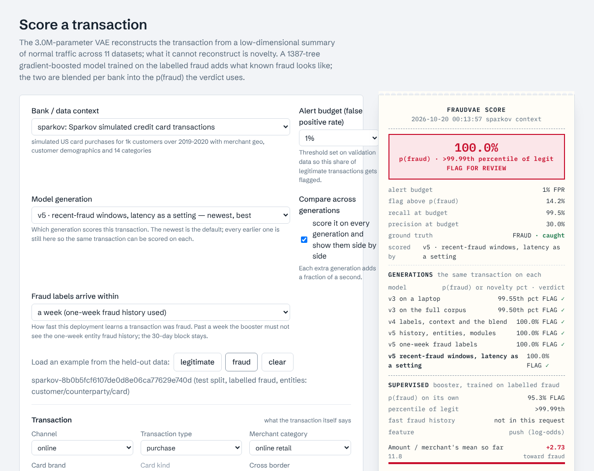

# fraudvae

Fraud screening for payment transactions, trained on a merged corpus of eleven
public transaction datasets (~43M rows), with a web UI to score new
transactions, browse the data, train locally, or push a training run to a
rented GPU over ssh.

**Try it without installing anything:** the demonstration site runs this
repository in its public mode, with every generation of the model loaded -
score a transaction on any of them, compare them side by side, read the story
of how they were built. **Every pretrained generation is on the
[Releases](https://github.com/deanOcoin/fraudvae/releases) page**, and
`fraudvae models pull v5-h200-h` drops the shipped one into `runs/` so the app
below scores with it in minutes; training it yourself is optional and
documented, not required.

Two models look at every transaction and a small per-bank blender combines
them - and, since v5, the signals of five more modules - into one probability:

- a **variational autoencoder** trained on legitimate traffic only. It scores a
  transaction by how badly it reconstructs it, field by field, so every score
  comes with a receipt of *which* fields looked unusual and what the model
  expected instead. This is the novelty detector: it never saw a fraud label.
- a **gradient-boosted booster** (LightGBM) trained on the labelled fraud, over
  the same fields plus a block of causal customer / merchant context (bursts,
  the customer's own amount z-score, tenure, first-time-at-this-merchant...).
  It finds the fraud that looks ordinary, and explains itself with per-feature
  SHAP pushes.
- the **blend**: a logistic layer fit on labelled validation rows with a
  weight per bank for each model, which is what the app flags on. Every bank
  also has a "generic" mode for transactions from an institution the model
  never trained on.
- **v5**: the VAE reads the customer's previous transactions through a small
  transformer, so "unusual" means unusual *for this customer*; a per-bank
  specialist booster, a device head and an entity-graph GNN add their own
  signals to the blend; text heads (urls, memos) and behavioural-biometrics
  verifiers (mouse, keystrokes, touch, motion) trained on public data are fused
  into the verdict when a request carries those payloads.



The other tabs: [data explorer](docs/img/data.png), [model & runs](docs/img/model.png)
(the generations and their [per-source results table](docs/img/model_results.png)),
[compute / remote training](docs/img/compute.png), [how it works](docs/img/explain.png),
[the story](docs/img/story.png).

## Quick start

```bash
python3 -m venv .venv && source .venv/bin/activate
pip install -e ".[dev]"

# score with the pretrained generations (no data needed; the example rows ship with the repo)
fraudvae models pull v5-h200-h     # the shipped generation, ~360 MB; `--all` for every one on the timeline
fraudvae serve                     # http://127.0.0.1:8765

# or train your own
fraudvae fetch                 # clones the github hosted sources (fdh, capone, tabformer)
#   kaggle ones: see scripts/kaggle_manual_download.md, drop the zips in data/raw/<key>/
fraudvae build                 # raw -> data/processed/<source>.parquet  (unified schema)
fraudvae prepare --max-rows-per-source 1500000     # parquet -> model arrays, train capped per source
fraudvae train --config cpu_small                   # VAE + booster + calibration + eval, ~1h on a laptop cpu
```

`make data build prepare train serve` does the same. `make test` runs the suite
(synthetic data, a 2 epoch model, the API, an in-process ssh server).

A faster machine gives you the same model sooner, not a better one: the
configuration that ships (`gpu_full`) is fixed, and a CPU gets there in days
where the rented H200 took three hours. `cpu_small` is a different, smaller
configuration (0.6M parameters on a capped corpus) that a laptop finishes in
half an hour - within 0.003 mean AUROC of the full run for v3 and v4, and
clearly below it for v5, whose history encoder needs the full corpus's long
customer sequences. `docs/TRAINING_NOTES.md` has every run's hardware and time;
the site's story page has the same as a table.

Python 3.10+, PyTorch 2.1+, LightGBM 4+. CPU is fine for the capped set, MPS
works on Apple silicon, CUDA for the full corpus.

**macOS:** LightGBM needs `brew install libomp`, and then `make fix-omp` once
per virtualenv. The PyTorch wheel carries its own copy of the OpenMP runtime
and LightGBM links the homebrew one; two copies in one process segfault it the
first time the booster runs. The script points torch at the homebrew copy
(reversible with `scripts/macos_openmp.sh --undo`). If you skip it the app
still starts, novelty-only, and the sidebar tells you why.

## What's in the corpus

| key | dataset | rows | fraud | access |
|---|---|---:|---:|---|
| fdh | Fraud Detection Handbook simulated card transactions | 1.75M | 0.84% | github |
| capone | Capital One synthetic card authorisations | 786k | 1.58% | github |
| tabformer | IBM TabFormer synthetic credit card transactions | 24.4M | 0.12% | github (lfs) / kaggle |
| ulb | ULB / Worldline real European card transactions | 285k | 0.17% | kaggle |
| paysim | PaySim mobile money simulation | 6.36M | 0.13% | kaggle |
| sparkov | Sparkov simulated US card purchases | 1.85M | 0.58% | kaggle |
| banksim | BankSim agent based bank payments | 595k | 1.21% | kaggle |
| ieee | IEEE-CIS / Vesta real e-commerce transactions | 590k | 3.5% | kaggle |
| amlworld | IBM AMLworld synthetic inter-bank transfers (HI-Small), label = laundering | 5.08M | 0.10% | kaggle |
| baf | Bank Account Fraud (Feedzai) account applications with device telemetry (v5) | 1.0M | 1.10% | kaggle |
| fraudecom | e-commerce first purchases with shared device ids (v5) | 151k | 9.4% | kaggle |

No dataset is redistributed here: each keeps its own licence (`docs/DATA_SOURCES.md`
has the links). All eleven are public. The GitHub-hosted ones need nothing; the Kaggle
ones need a free Kaggle account (IEEE-CIS additionally means joining its competition
and accepting the rules, and is non-commercial), and Kaggle refuses some VPN exit
addresses. `fraudvae fetch` downloads what it can, says what to fetch by hand and where
to put it (`scripts/kaggle_manual_download.md`), and then checks every file against
`fraudvae/data/expected.json` - the size and sha256 of each raw file the shipped
generations were built from (`fraudvae fetch --verify` does only the check). That
check is the part that matters: datasets get re-uploaded and re-cut, and a file that
differs will build and train but will not reproduce the numbers in the docs. The six
sources whose licences allow it ship a few hundred labelled rows from the held-out
test split in `data/examples/` (`fraudvae examples` regenerates them from a build),
which is what the score tab's example picker uses on a machine without the data - the
demonstration site included.

Every source is mapped onto one schema (`fraudvae/data/schema.py`, v5): 95
numeric fields (amount, hour, the customer's history in the last hour / day /
week / month and their own amount z-score, tenure, the merchant's volume and
typical amount, balances, limits, distances, and the v5 *graph block*: each
entity's 30-day volume, distinct customers seen with it, age and
30-day-delayed confirmed fraud for the counterparty, device, e-mail domain,
address and card), 24 categoricals (channel, transaction type, an 18-way
merchant category taxonomy, card brand/kind, auth errors, first-time flags,
payment format, OS and browser family...), plus a source id and six entity
keys (customer, counterparty, card, device, email, address) that drive the
sequence index and the graph block but never enter a model. Each source may
also carry a *wide block* of its own raw columns (IEEE-CIS: 431 of them)
stored beside the common table and read only by the booster. Fields a source
can't fill are *unobserved* and masked out of the likelihood, never imputed.
All context features are computed causally per source. Splits are by time
within each source: oldest 70% train, 10% validation (calibration), newest
20% test. Details, licenses and per-source quirks: `docs/DATA_SOURCES.md`,
`docs/SCHEMA.md`; the v5 plan and data assessment: `docs/ROADMAP_V5.md`.

## The models

**Novelty (VAE).** A heterogeneous-likelihood VAE (HI-VAE style): MLP encoder
over `[standardised numerics, mask bits, embedded categoricals, embedded
source]` into a 16-24-d Gaussian posterior, mirrored decoder with a Gaussian
head per numeric field and a softmax head per categorical. Trained on
legitimate rows only with β warm-up and source-token dropout (so a "generic"
bank context exists). Scoring is a Monte Carlo −ELBO plus a per-field
normalised variant; calibration picks the better one on validation.

**Customer history (v5).** A small transformer, the history encoder, reads
the customer's previous 16-32 transactions (same field encoding, plus the
log time gap to each) into a vector `h` that conditions both the encoder
`q(z|x,h,s)` and the decoder `p(x|z,h,s)`: "unusual" becomes unusual *for
this customer*. 10% history dropout keeps a learned no-history token
trained for first transactions and callers that send none. A sequence head
(MLP on `[h, embedding of x]`, trained on the labelled subsample) turns the
same read-out into a fourth supervised signal. The server keeps a per-customer
store of what it has scored, so the API needs only a `customer_id` (or an
explicit `history` list) to score with context.

**Supervised (booster).** A LightGBM classifier on the same fields (NaN where
unobserved) plus the source token and the source's wide block, trained on the
labelled train split with legit rows subsampled per source and re-weighted
(capped, so no bank outweighs the others), early-stopped on the mean of the
named-bank and source-blanked validation AUCs, with a 25% source-blanked slice
for a generic mode. It never sees a VAE output, which keeps the stacking
honest.

**Device head and entity graph (v5).** A small MLP over the device block alone
("what a risky device looks like", learned across every source that has one) and,
per source, a GraphSAGE over the entity graph - customers, counterparties, devices,
emails, addresses, cards as nodes, transactions as edges, three time snapshots so a
row never sees its own label - whose transaction head reads a row's entities'
embeddings. Each is one more calibrated signal with a presence bit.

**Text and behaviour (v5).** fastText-style heads trained on public text-fraud
sets (malicious URLs, scam job postings, bot profiles) read a `text` payload;
behaviour verifiers trained on public biometric sets (Balabit, BB-MAS, HMOG)
compare a `session` of raw mouse / keystroke / touch / motion events with the
customer's enrolled profile. Both return calibrated likelihood ratios that are
*fused* into the verdict (added to the blend's log-odds with a fixed weight),
because no transaction row ever carried text or a session.

**Blend.** One logistic regression on bounded signals - booster logit,
VAE score z, KL z and (v5) the sequence, device and graph logits, each with a
presence bit - with a source one-hot and the signals × one-hot, fit on labelled
validation rows. The interaction terms give every bank its
own booster-vs-novelty weighting. Calibration then scores the whole
validation split once and records, per bank and for the generic context,
operating thresholds at 0.1/0.5/1/2/5% false positive rate for every
score. The app flags on the blend; the receipt shows them all.

`docs/ARCHITECTURE.md` has the longer version, the UI's "How it works" tab
the friendly one.

## Results

Held-out test split: the newest 20% of every source, 8.57M rows, 27k fraud,
thresholds frozen on validation. `v5-h200-h` is the full 30M-row v5 corpus
trained on a rented H200 through the relay (30 epochs of the history-conditioned
VAE in 2.9 h, then the booster, the specialists, the sequence / device / graph
heads, the text and behaviour modules, calibration and evaluation as a 30-minute
`post` stage). Two blend columns: as trained, for a deployment whose fraud labels
arrive within a week, and the same model scored as one whose labels take a month
(the one-week fraud-history block blanked - `label_delay_days` on the API, the
"labels arrive within" control in the UI). The last two columns are
`gpu_full-4090-v4`, the previous release on the same nine sources. `runs/` is not
in git: `fraudvae models pull --all` fetches every generation on this timeline from
the Releases page (`fraudvae/pretrained.json` is the manifest it verifies against),
or train your own with the commands above.

| source | VAE | booster | seq | local | device | graph | **blend** | r@1% FPR | 30-day labels: blend / r@1% | v4 blend | v4 r@1% |
|---|---|---|---|---|---|---|---|---|---|---|---|
| fdh | 0.624 | 0.903 | 0.656 | 0.905 | – | 0.501 | **0.905** | 78% | 0.679 / 34% | 0.672 | 34% |
| capone | 0.613 | 0.837 | 0.815 | 0.839 | – | 0.767 | **0.841** | 21% | 0.836 / 19% | 0.765 | 8% |
| tabformer | 0.940 | 0.991 | 0.985 | 0.995 | – | 0.815 | **0.994** | 86% | 0.986 / 73% | 0.981 | 73% |
| ulb | 0.962 | 0.986 | 0.987 | 0.985 | – | – | **0.984** | 89% | 0.984 / 89% | 0.982 | 84% |
| paysim | 0.797 | 1.000 | 0.991 | 1.000 | – | 0.554 | **1.000** | 100% | 1.000 / 100% | 1.000 | 100% |
| sparkov | 0.863 | 1.000 | 0.996 | 1.000 | – | 0.953 | **1.000** | 100% | 1.000 / 100% | 0.999 | 99% |
| banksim | 0.990 | 0.999 | 0.999 | 1.000 | – | 0.998 | **1.000** | 99% | 0.999 / 99% | 0.999 | 97% |
| ieee | 0.795 | 0.958 | 0.904 | 0.955 | 0.733 | 0.825 | **0.958** | 63% | 0.940 / 56% | 0.858 | 35% |
| amlworld | 0.912 | 0.990 | 0.984 | 0.990 | – | 0.846 | **0.990** | 85% | 0.990 / 85% | 0.990 | 84% |
| baf | 0.658 | 0.893 | 0.812 | 0.891 | 0.768 | – | **0.893** | 25% | 0.893 / 25% | – | – |
| fraudecom | 0.641 | 0.645 | 0.644 | 0.639 | 0.639 | 0.516 | **0.641** | 10% | 0.641 / 9% | – | – |
| **mean (11)** | 0.799 | 0.927 | 0.889 | 0.927 | 0.714 | 0.753 | **0.928** | | 0.904 | | |
| **mean (v4's 9)** | 0.833 | 0.963 | | | | | **0.963** | | 0.935 | 0.916 | |
| generic (bank unknown) | 0.625 | 0.969 | 0.930 | – | 0.735 | – | **0.969** | 70% | 0.952 / 62% | 0.956 | 66% |

AUROC unless marked; r@1% FPR is the share of fraud caught at a 1% false-positive
budget; `seq` is the sequence head on the history encoder, `local` the bank's own
specialist booster, `device` and `graph` the device-block and entity-graph heads
(only where a source carries those columns). The honest reading: the new columns
are the step change - the entity-graph block with its delayed fraud labels lifted
Capital One from 0.77 to 0.84 (8% → 21% of its fraud at 1% FPR); the same labels
at a one-week delay with 7 / 30-day windows (the Fraud Detection Handbook's
assumption about label latency, booster-only, `docs/SCHEMA.md`) took fdh from
0.67 to 0.91 (34% → 78%) and tabformer from 73% to 86% of its fraud; the graph
block plus the wide blocks took IEEE from 0.86 to 0.96 (35% → 63%) - while the
extra models are second opinions that the blend uses where they help and ignores
where they do not. The month-latency column is the same model with the one-week
block blanked, which the booster was trained to expect: it lands where the model
stood before that block existed. The simulators (PaySim, Sparkov, BankSim)
saturate because their fraud rules are learnable; fraudecom's fraud is a shared
device, and 95% of its test rows are a device seen for the first time. The
modules trained on their own public data keep their own numbers
(`docs/TRAINING_NOTES.md`): the URL head 0.994 AUROC, the free-text head 0.972,
the profile head 0.783; the behaviour verifiers 0.11 (keystroke), 0.12 (motion),
0.17 (touch) and 0.24 (mouse) equal error rate; the graph encoder 0.78 / 0.88 /
0.92 / 0.98 on DGraph-Fin / Elliptic / YelpChi / Amazon. `docs/TRAINING_NOTES.md`
has the per-run commentary, including the features that made tabformer worse
before they made everything else better, the blender that memorised ULB's 21
validation fraud rows, why a 30-day-old label can never catch a terminal that is
compromised for 28, and the two things that did not help (the transformer's
summary as booster input, a longer VAE).

## The generations

Six trained generations are kept, so the model's progress is something you can score
a transaction on rather than read about: the score tab's **Model generation** picker
takes any of them and **Compare across generations** scores one transaction on all
six. The UI's development-process tab (and `docs/TRAINING_NOTES.md`) tells what changed at each step
and what did not work; the model tab's timeline shows each one's hardware, training
time and numbers.

| generation | schema | trained on | time | mean AUROC, 9 shared banks |
|---|---|---|---|---|
| `cpu_small-8src` | v3 | 2 CPU cores, 8 sources capped at 1.5M rows | 33 min | 0.829 (its 8) |
| `gpu_full-4090` | v3 | 1× RTX 4090, 8 sources, every row | 19 min | 0.833 (its 8) |
| `gpu_full-4090-v4` | v4 | 1× RTX 4090, 9 sources, every row | 18 min + 8 min post | 0.916 |
| `v5-h200-e` | v5 | 1× H200 NVL, 11 sources, every row | 2.9 h + 40 min post | 0.936 |
| `v5-h200-f` | v5 | e's VAE, booster side refit (one-week labels) | + 30 min post | 0.961 |
| `v5-h200-h` | v5 | e's VAE, booster side refit (recent-fraud windows, latency dropout) | + 41 min post | **0.963** |

## Hosting it

`docs/DEPLOY.md`: `FRAUDVAE_PUBLIC=1` turns the app into the demonstration site -
no training, no data build, no remote routes, no visitor state, rate limits per
address - and `deploy/` has the install script, the systemd unit and the nginx
configuration the site runs on.

## Remote training

The full corpus is ~29M legitimate rows per epoch; a laptop does it in days,
an RTX 4090 in about a minute per epoch. The *Compute* tab benchmarks the real model on your machine,
estimates the run, and if it's too long walks through renting a box:

1. the app generates its own ed25519 key (`~/.fraudvae/ssh/`); add the public
   key to the server (vast.ai: Account → SSH keys, then rent with the PyTorch
   template and direct ssh on)
2. paste the instance's `ssh -p PORT root@IP` line, *Connect & inspect* shows
   GPU/RAM/disk/torch
3. *Provision* uploads code + processed parquet, installs deps, runs `prepare`
   on the box
4. *Launch* starts `fraudvae train` under nohup; *Refresh status* tails the
   log and per-epoch metrics; *Fetch* pulls the run back and loads it

Everything in that flow is also plain CLI: `fraudvae key`, `fraudvae advise`,
`fraudvae remote run --host IP --port PORT` (provision + launch + poll + fetch
in one command), `scripts/bootstrap_remote.sh`. See `docs/REMOTE_TRAINING.md`.

## Layout

```
fraudvae/
  data/        registry (sources, licenses), schema, taxonomy, velocity features,
               entities.py (graph block), adapters/<source>.py, fetch / build / prepare,
               examples.py (the redistributable example rows)
  models.py    pretrained bundles: pack / pull against pretrained.json (github releases)
  model/       vae.py (model + history encoder), scoring.py, booster.py,
               seqhead.py (sequence head), heads.py (device head), dataset.py (+ the sequence index)
  graph/       entity-graph snapshots, GraphSAGE, per-source training, scorer, public benchmarks
  text/        hashed-bag text heads (url / free text / profile), training, scorer
  behaviour/   mouse / keystroke / touch / motion features, verifiers, training, scorer
  train.py  calibrate.py  evaluate.py  config.py
  remote/      keys, ssh (paramiko), provision (incl. raw-data push + box-side pipeline),
               jobs, advisor, relay (a git repo as the laptop-off control channel)
  server/      fastapi app + api modules, inference (the loaded generations + fusion), timeline,
               public (the demonstration-site mode), entity_store, payloads
  web/         the ui: index.html, css/, js/, explain.html, story.html + story_plain.html, vendored libs
configs/       base, cpu_small, gpu_full, smoke
data/examples/ labelled example rows for the six sources whose licences allow it
deploy/        install.sh, update.sh, the systemd unit, nginx, env.example, relay_bootstrap.sh
tests/         pytest, no real data needed
docs/
```

## License

MIT for the code. The datasets keep their own licenses (listed per source in
`fraudvae/data/registry.py` and `docs/DATA_SOURCES.md`); IEEE-CIS in particular
is non-commercial.
